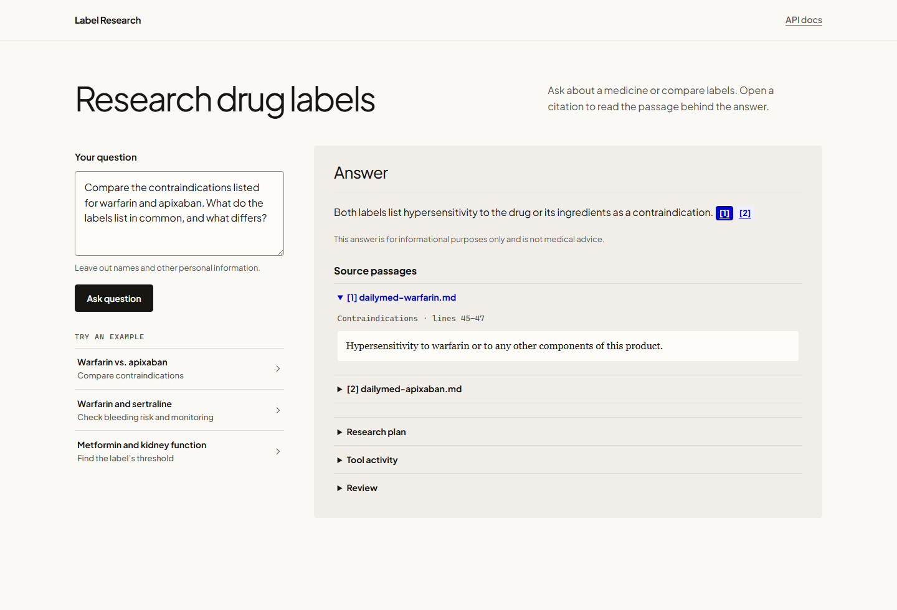
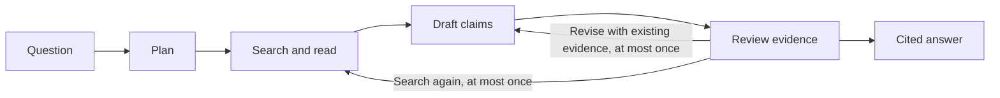

<div align="center">

# Label Research

**Compare drug labels and read the passages behind each answer.**

<p>
  <a href="https://www.python.org/"></a>
  <a href="https://fastapi.tiangolo.com/"></a>
  <a href="https://github.com/langchain-ai/langgraph"></a>
  <a href="https://numpy.org/"></a>
  <a href="https://docs.pydantic.dev/"></a>
  <a href="https://www.docker.com/"></a>
</p>

[Quick start](#quick-start) · [How it works](#how-it-works) · [API](#api) · [Evaluation](#evaluation)

</div>



*Interface preview with a mocked response.*

Label Research searches a bundled collection of 21 documents, including
DailyMed labels, MedlinePlus entries, and a glossary. Ask about a contraindication,
compare two labels, or trace an interaction across sources. The answer links to
the original passages, and the interface shows the research plan, tool calls,
and review findings.

> For research and education. Answers are not medical advice.

## Quick start

Run the commands from the repository root. Use the assignment's supplied
`.env`, or copy [`.env.example`](.env.example) to `.env` and set:

| Variable | Value |
| --- | --- |
| `OPENAI_API_KEY` | Your provider API key |
| `OPENAI_BASE_URL` | The assignment's LiteLLM URL |
| `OPENAI_MODEL` | The chat model assigned to you |
| `OPENAI_EMBEDDING_MODEL` | Optional. Defaults to `text-embedding-3-small`. |

Environment variables take precedence over `.env`. The app also accepts
`OPENAI_BASE_UR` from the supplied configuration when `OPENAI_BASE_URL` is unset.

### Docker

```sh
docker build -t agent .
docker run -p 8000:8000 --env-file .env agent
```

### Local Python

With Python 3.13 and `uv` installed:

<details>
<summary>Windows PowerShell</summary>

```powershell
uv venv --python 3.13
uv pip sync --python .venv\Scripts\python.exe requirements.txt
.\.venv\Scripts\python.exe main.py
```

</details>

<details>
<summary>macOS or Linux</summary>

```sh
uv venv --python 3.13
uv pip sync --python .venv/bin/python requirements.txt
.venv/bin/python main.py
```

</details>

Open [localhost:8000](http://localhost:8000) after startup and try
**“Compare the contraindications listed for warfarin and apixaban.”**
Select an inline citation to open its source passage.

## How it works



- **Research.** The model selects `search_corpus` and `read_section` calls. Search
  ranks passages in memory with NumPy cosine similarity. If embeddings are
  unavailable, it uses local TF-IDF search.
- **Review.** A separate critic checks claims against the evidence. The workflow
  can revise and review the draft once. Claims that fail review are withheld.
- **Citations.** The server checks evidence IDs and builds citations from original
  source text, with the filename, line range, and excerpt.

FastAPI serves the API and browser interface in one process, and LangGraph
coordinates the workflow. Startup uses the configured endpoint to embed the
corpus. Chat requests send the question and selected passages to that endpoint.

## API

| Route | Purpose |
| --- | --- |
| `GET /` | Research interface |
| `GET /health` | Returns 200 when the app and search index are ready |
| `POST /ask` | Accepts a `question` and returns the answer, citations, plan, tool activity, and review |
| `GET /docs` | Interactive API documentation |

```sh
curl -X POST http://localhost:8000/ask \
  -H 'Content-Type: application/json' \
  -d '{"question":"Compare warfarin and apixaban contraindications."}'
```

Evidence gaps return HTTP 200 with a `partial` or `insufficient_evidence`
status. A chat rate limit returns 429. Other upstream failures return
502 or 504.

## Evaluation

With the app running and model access configured, run the four public cases:

```sh
python evals/run.py --group public --output evals/report.json
```

The runner checks response structure, source excerpts, and citations. Review
the answers against the rubric in the report to judge whether they cover the
question and preserve the source qualifications. Use `--group all` to include
the additional cases.

For offline checks, activate the project virtual environment and run:

```sh
uv pip install pytest==9.0.2 ruff==0.14.14
python -m pytest -q
ruff check app tests evals main.py
```

The tests simulate model responses to exercise retrieval, citations, review,
and error handling without provider calls.

[Demo walkthrough](docs/demo.md) · [Development notes](docs/development.md)
